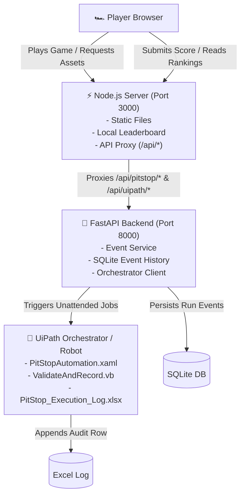

# 🏎️ F1 Pit Stop Simulator

[](https://github.com/BoomDino/pit-stop-simulator/actions/workflows/ci.yml)
[](https://nodejs.org/)
[](https://python.org/)
[](https://fastapi.tiangolo.com/)
[](https://www.uipath.com/)
[](LICENSE)

An interactive, high-performance Formula 1 pit stop timing simulation game. Step into the shoes of an F1 pit crew and execute precision timing challenges across six critical pit stops under extreme pressure — complete with procedural audio synthesis, dynamic particle visuals, local leaderboard persistence, and an optional **UiPath Robotic Process Automation (RPA)** verification backend.

---

## 📸 Overview & Features

- ⏱️ **Precision Timing Challenges**: Face 6 sequential pit stop procedures with dynamic rotating dials, variable target zones, and sub-millisecond reaction tracking.
- 🔊 **Procedural Web Audio Engine**: Zero external audio files required! Synthesizes realistic wheel gun impacts, pneumatic whines, air jack lifts, engine idle revs, and countdown beeps using the native Web Audio API.
- ✨ **Dynamic Visual Effects & Canvas Particles**: Sparks, smoke bursts, wrench rotational animations, and realistic road textures.
- 🏆 **Local Leaderboard**: Stores and ranks your fastest pit stop times, accuracy ratings, and perfect hit counts in a persistent JSON database.
- 📊 **Live Telemetry & Diagnostics**: Real-time sensor readout simulations (pneumatic gun pressure, wheel nut torque, tire temperatures).
- 🤖 **Enterprise UiPath RPA Integration (Optional)**: Complete workflow (`PitStopAutomation.xaml`) connecting to UiPath Orchestrator to validate wheel sequences and audit pit events directly into Excel (`PitStop_Execution_Log.xlsx`).
- 🛡️ **Secure Architecture**: Static file server enforces strict path allowlisting to safeguard credentials, database files, and system paths.
- 🚀 **Deploy-Ready**: Native configuration for one-click deployment on Render via `render.yaml`.

---

## 🕹️ Game Mechanics: The 6 Pit Stop Stages

Each run tests your reflexes across all corners of the Formula 1 car:

| Stage # | Operation | Description | Target Zone |
| :---: | :--- | :--- | :--- |
| **1** | **Front Left Wheel (FL)** | Remove old compound, fit fresh softs, torque wheel nut | Tight precision window |
| **2** | **Front Right Wheel (FR)** | Right-side front crew execution and verification | Dynamic sweep zone |
| **3** | **Rear Left Wheel (RL)** | Rear axle gunner timing under heavy engine heat | High-speed rotation dial |
| **4** | **Rear Right Wheel (RR)** | Final wheel change completion | Precision lock-in |
| **5** | **Front Wing Flap Adjust** | Aerodynamic downforce tuning with torque wrench | Calibrated angle target |
| **6** | **Lollipop / Car Release** | Drop the jacks and signal green light to launch the racer | Instant reaction check |

> **Controls**: Press **Spacebar** or click the **Dial Action Button** when the sweeping needle hits the green target zone. Missed attempts incur time penalties!

---

## 🏗️ Architecture



---

## 🚀 Quick Start (Local Run)

The game runs 100% locally with Node.js and **does not require Python or UiPath** to play!

### Prerequisites
- [Node.js](https://nodejs.org/) v18.0.0 or higher.

### 1. Clone the Repository
```bash
git clone https://github.com/BoomDino/pit-stop-simulator.git
cd pit-stop-simulator
```

### 2. Start the Server
```bash
npm start
# or: node server.js
```

### 3. Open in Browser
Visit **`http://localhost:3000`** in your favorite browser.

---

## 🐍 Optional: Python FastAPI Backend

To enable server-side event tracking and telemetry reconciliation:

1. **Create and activate a virtual environment**:
   ```bash
   python -m venv .venv
   source .venv/bin/activate  # On Windows: .venv\Scripts\activate
   ```

2. **Install backend dependencies**:
   ```bash
   pip install -r backend/requirements.txt
   ```

3. **Configure environment**:
   ```bash
   cp backend/.env.example backend/.env
   ```

4. **Launch FastAPI**:
   ```bash
   python -m uvicorn backend.main:app --host 127.0.0.1 --port 8000
   ```

`server.js` will automatically detect the FastAPI backend on port 8000 and proxy `/api/pitstop/*` and `/api/uipath/*` calls.

---

## 🤖 Optional: UiPath RPA Integration

The project includes an enterprise automation package for UiPath Orchestrator:
- **Workflow**: [`uipath/PitStopAutomation.xaml`](uipath/PitStopAutomation.xaml)
- **Validation Logic**: [`uipath/ValidateAndRecord.vb`](uipath/ValidateAndRecord.vb)
- **Audit Template**: [`uipath/PitStop_Execution_Log.xlsx`](uipath/PitStop_Execution_Log.xlsx)

### Features:
- Dispatches Unattended Robot jobs via Orchestrator REST API (`StartJobs`).
- Independent verification of wheel sequences (rejects out-of-order stage completion).
- Atomic OOXML Excel log recording using .NET without requiring Microsoft Office installed on the robot machine.
- Deduplication of events ensuring robust fault recovery.

For complete Orchestrator configuration, robot permissions, and environment setup, see the **[UiPath Setup Guide](uipath/README.md)**.

---

## 🧪 Testing

The repository features comprehensive automated test suites covering both frontend logic and backend services:

```bash
# Run all tests (Node.js + Python)
npm test

# Run frontend & static server tests only
npm run test:node

# Run Python FastAPI & test doubles suite
npm run test:python
```

---

## ☁️ Deployment on Render

This repository includes a [`render.yaml`](render.yaml) blueprint:
1. Connect this GitHub repository to [Render](https://render.com).
2. Create a new Web Service using the **Blueprint**.
3. Render automatically provisions the Node.js frontend and FastAPI backend with a persistent disk for leaderboard rankings and SQLite logs.

---

## 📁 Project Structure

```text
pit-stop-simulator/
├── assets/                  # High-resolution car cutout, road texture, and background
├── backend/                 # Optional Python FastAPI service
│   ├── config.py            # Environment configuration & OAuth settings
│   ├── database.py          # SQLite audit store
│   ├── event_service.py     # Stage progression & robot job orchestration
│   ├── main.py              # FastAPI application & route endpoints
│   ├── reconcile.py         # Operator recovery CLI
│   ├── requirements.txt     # Python dependencies
│   └── uipath_service.py    # UiPath Cloud & on-prem OAuth client
├── css/                     # Styling, responsive layout & monitor UI
├── js/                      # Frontend game engine
│   ├── audio.js             # Procedural Web Audio API sound generator
│   ├── game.js              # State machine, timing dial, and stage logic
│   ├── leaderboard.js       # Score formatting and rankings UI
│   ├── particles.js         # Canvas spark & smoke particle animations
│   └── rpa-engine.js        # RPA communication & telemetry state monitor
├── tests/                   # Automated test suites
│   ├── frontend.test.cjs    # Stage logic & offline recovery tests
│   ├── live_smoke.py        # Live Orchestrator smoke tester
│   ├── server.test.cjs      # Static server & security allowlist tests
│   └── test_backend.py      # FastAPI ASGI in-process unit tests
├── uipath/                  # UiPath RPA assets
│   ├── PitStopAutomation.xaml      # Main workflow file
│   ├── PitStop_Execution_Log.xlsx  # Excel audit workbook template
│   ├── ValidateAndRecord.vb        # Embedded .NET code source
│   └── README.md                   # Complete UiPath setup instructions
├── .github/workflows/       # GitHub Actions CI workflow
├── index.html               # Main game interface
├── leaderboard.json         # Local persistent score store
├── package.json             # Node package definition & scripts
├── render.yaml              # Render deployment blueprint
├── server.js                # Static web server & API proxy
└── start-game.bat           # Quick launcher for Windows users
```

---

## 📄 License

This project is open-source under the [MIT License](LICENSE).
Developed with ❤️ by [BoomDino](https://github.com/BoomDino).
